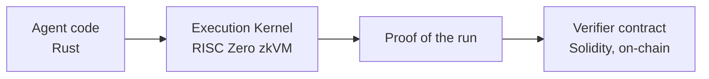

  

  

  
  
  
  

I'm a lead engineer at @mantiq-technologies. I work on the parts of a system where a bug costs someone money: exchanges, custody, smart contracts, zero-knowledge proofs. More recently that includes AI agents, and making them prove what they did.

I trained as an engineer (statistics and signal processing), then did a Master in Finance at ESSEC and a stint on the exotic equity derivatives desk at Natixis. So I can sit down with a trading or compliance team, work out what they actually need, and build it myself. I speak French, English and Arabic.

## Right now

**An exchange for tokenised real-world assets, settled on Solana.** Rust from top to bottom: Axum and Leptos on the web side, Postgres through SQLx, Anchor programs on-chain. I work on the exchange core: the order book and its settlement, token issuance under Token-2022, custody with a separate signing service, and the vault and escrow programs. The code is private, but I'm happy to talk through the design.

**[Triffin](https://triffin.app), on the side.** You photograph your meal. A model names the dish, counts the calories and protein, and tells you what to eat next. I built it on my own, from the app to the backend to the billing, and it is on the App Store.

## Things I've built

<table>
  <tr>
    <td width="50%" valign="top">
      <h3><a href="https://github.com/Defiesta/execution-kernel">Execution Kernel</a></h3>
      
An autonomous trading agent runs inside a zkVM and comes out with a proof that it stayed within its limits. I designed and wrote it, and the same kernel is now the base of <a href="https://github.com/tokamak-network/Tokamak-AI-Layer">Tokamak's agent layer</a>.

      
      
      
    </td>
    <td width="50%" valign="top">
      <h3><a href="https://eprint.iacr.org/2025/1390">zk-EVM verifier</a></h3>
      
First author of the paper. On-chain proof verification went from 857,200 gas to 748,450. I also wrote a large part of the rollup's <a href="https://github.com/tokamak-network/Tokamak-zk-EVM-contracts">Layer 1 contracts</a>.

      
      
    </td>
  </tr>
  <tr>
    <td width="50%" valign="top">
      <h3><a href="https://github.com/tokamak-network/gem-nft-contract">GemSTON</a></h3>
      
NFTs backed by staked TON, with a marketplace and the liquid staking token underneath. I wrote nearly all of it.

      
      
    </td>
    <td width="50%" valign="top">
      <h3><a href="https://github.com/Mehd1b/Poseidon-bls12381-EVM">Poseidon for BLS12-381</a></h3>
      
Poseidon hashing for the EVM. About 33K gas per hash in Yul, against 440K in plain Solidity. Not audited, so read it before you rely on it.

      
      
    </td>
  </tr>
</table>

How the Execution Kernel fits together:

**Security reviews**  
I review contracts before they ship. Some of what I found is public: [staking v2](https://github.com/tokamak-network/ton-staking-v2/issues?q=is%3Aissue+author%3AMehd1b), the [Thanos bridge](https://github.com/tokamak-network/tokamak-thanos/issues?q=is%3Aissue+author%3AMehd1b) and [Commit-Reveal²](https://github.com/tokamak-network/Commit-Reveal2/issues?q=is%3Aissue+author%3AMehd1b).

## What I work with

**Zero-knowledge:** Groth16, circom and snarkjs, verifier design, the BLS12-381 precompiles.  
**AI:** model features in a shipped product, agent runtimes, agents whose actions can be verified.

## Activity

  

  

  <picture>
    <source media="(prefers-color-scheme: dark)" srcset="https://raw.githubusercontent.com/Mehd1b/Mehd1b/output/github-contribution-grid-snake-dark.svg" />
    <source media="(prefers-color-scheme: light)" srcset="https://raw.githubusercontent.com/Mehd1b/Mehd1b/output/github-contribution-grid-snake.svg" />
    
  </picture>

## Get in touch

mehdiberiane@gmail.com · [mehd1b.github.io](https://mehd1b.github.io)

If the role means sitting next to the customer and shipping what they need that week, I'd like to hear about it.
